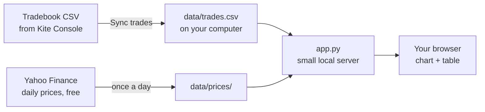

<div align="center">

# 📈 zerodha-portfolio-analyser

**See every buy and sell you ever made, right on the price chart.**

A small, private, local app for your Zerodha Kite portfolio.<br/>
Drop in your tradebook → get a clean view of each stock and ETF you own.


 

<sub>Screenshots use made-up sample trades.</sub>

</div>

---

## ✨ What you get

- **One page per stock or ETF** — quantity, average buy price, invested, current value, profit or loss.
- **Daily price chart with your trades on it** — 🟢 green dots are buys, 🔴 red dots are sells. **Bigger dot = more shares.**
- **Click a dot → its order lights up in the table.** Click a row → its dot lights up on the chart.
- **Zoom and drag** the chart to look at any time period.
- **Sync in one step** — download your tradebook from Kite, drop it in. Only new trades are added. Drop the same file twice and nothing is added twice.
- **Light and dark theme** — one click, and it remembers your choice.
- **Handles the tricky bits**
  - An order filled in several parts is shown as **one** order.
  - **Splits and bonus shares** are found automatically, so old orders match today's share count.
  - Sold-out stocks stay in a **Sold** list, with the profit or loss you booked.
  - If a stock was renamed or something is missing, the app tells you in plain words.

## 🚀 Start in 30 seconds

You only need **Python 3.9 or newer** (already on most Macs). Nothing to install.

```bash
git clone https://github.com/SouravAggarwal/zerodha-portfolio-analyser.git
cd zerodha-portfolio-analyser
python3 app.py
```

Your browser opens at **http://localhost:8000**. Click **Sync trades** to add your first file.

## 📥 Which file to download from Kite

1. Open **[Kite Console → Reports → Tradebook](https://console.zerodha.com/reports/tradebook)**.
2. Set **Segment** to **Equity**.
3. Pick the dates. Kite has quick picks: **prev. FY** and **current FY**.
4. Click **View** (the → button), then **Download: CSV** at the top right of the list.

**First time:** download one file per financial year, all the way back to your first trade. You can drop all the files in together.<br/>
**After that:** the Sync window shows the date of your last saved trade. Download from that day to today.

> F&O, currency and commodity rows are skipped. This app is for stocks and ETFs.

## 🧠 How it works



- **Trades** are kept in `data/trades.csv`. Each trade is matched by its trade ID, so repeats are skipped.
- **Prices** are daily closing prices from Yahoo Finance. They are saved in `data/prices/` and refreshed once a day.
- **Profit or loss** uses the average-cost method. When you sell, the cost of those shares is your average buy price at that time.

## 🔒 Privacy

- Everything runs on **your own computer**. There is no account, no cloud and no tracking.
- Your trades are never sent anywhere. The only thing the app asks the internet for is **daily prices by stock name** (for example `INFY.NS`), and the chart library.
- The `data/` folder is in `.gitignore`, so your trades are never committed by mistake.
- The app never logs in to Kite. You download the file yourself.

## ❓ Common questions

<details>
<summary><b>A stock says "No daily prices found"</b></summary>

The stock was probably renamed or delisted, so Yahoo knows it by a new name. Create `data/tickers.json` and map the old name to the new Yahoo name:

```json
{ "OLDNAME": "NEWNAME.NS" }
```

Find the new name by searching the company on [finance.yahoo.com](https://finance.yahoo.com). NSE names end in `.NS`, BSE names end in `.BO`.
</details>

<details>
<summary><b>It says "some buys are missing"</b></summary>

You sold more shares than the tradebook shows you bought. This happens with **IPO shares**, **gifts**, **shares moved in from another broker**, or a **demerger**, because those are not trades. The chart still works. Only the profit or loss for that stock may be off.
</details>

<details>
<summary><b>Some orders say "adj."</b></summary>

There was a split or bonus issue after that order. The quantity and price are changed to today's share count so they line up with the chart. The amount you paid is the same.
</details>

<details>
<summary><b>Can I use another port?</b></summary>

```bash
PORT=9000 python3 app.py
```
</details>

## 🗂️ Project files

```
app.py          the local server: reads tradebooks, gets prices, works out holdings
web/            the page: index.html, app.js, style.css (charts by Apache ECharts)
data/           your trades and cached prices (created on first sync, never committed)
docs/           screenshots
```

## 🛣️ Ideas for later

- Whole-portfolio view: how much is in each stock, sector and ETF
- Yearly return (XIRR) per stock and for the whole portfolio
- Compare each stock with the Nifty 50 over the same time
- Best and worst trades, and how long you held them
- Dividends from the Kite Console dividend report

Ideas and pull requests are welcome.

## ⚠️ Disclaimer

This is a personal, open-source project. It is **not made by or linked to Zerodha**. "Kite" and "Zerodha" belong to their owners.
Prices come from Yahoo Finance and may be late or wrong. This app is not investment advice. Always check important numbers in Kite Console.

## 📄 License

[MIT](LICENSE)
