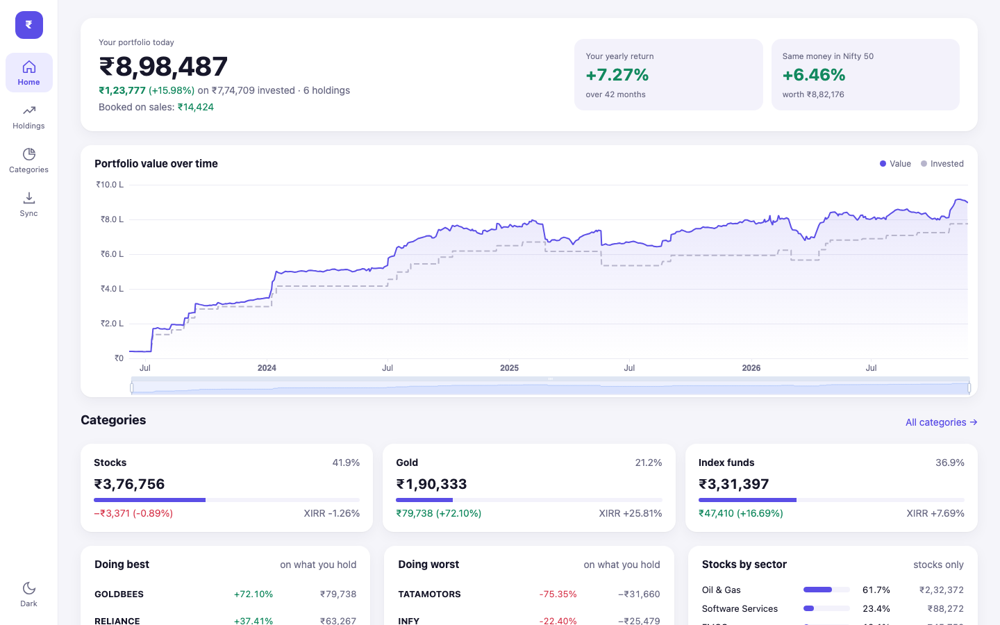
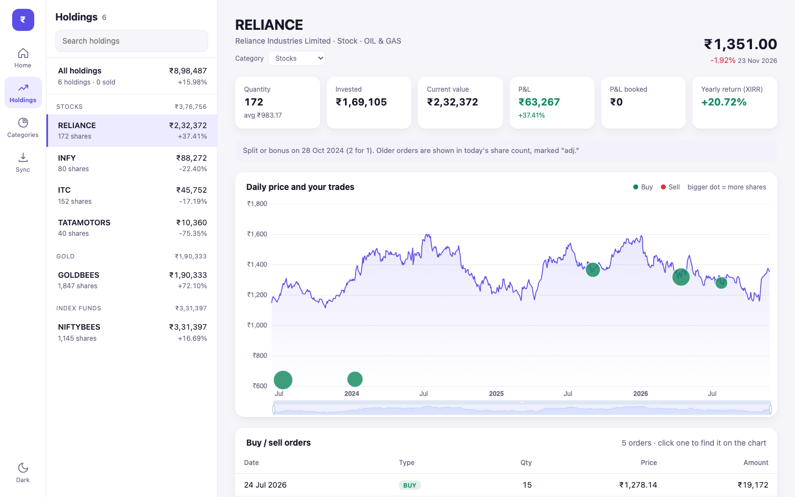
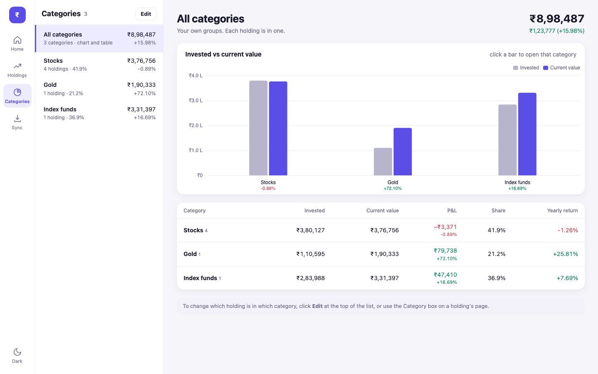
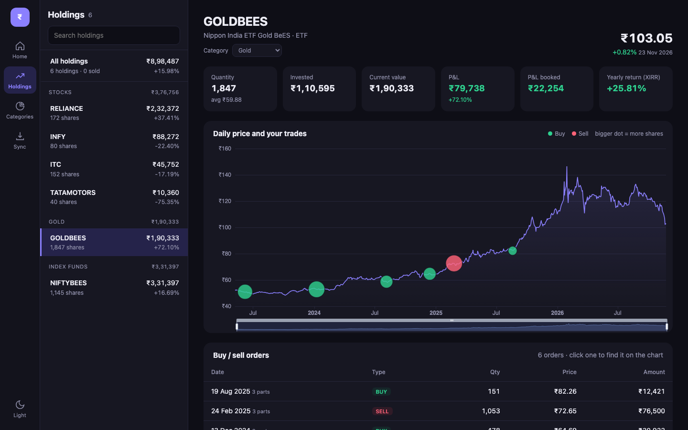
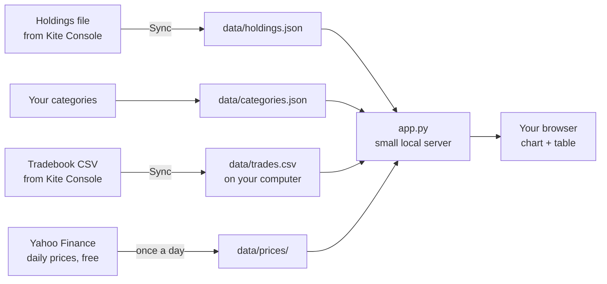

<div align="center">

# 📈 zerodha-portfolio-analyser

**See every buy and sell you ever made, right on the price chart — plus your real yearly return, your own categories, and how you did against the Nifty 50.**

A small, private, local app for your Zerodha Kite portfolio.<br/>
Drop in your tradebook → get a clean view of each stock and ETF you own.


 
 

<sub>Screenshots use made-up sample trades.</sub>

</div>

---

## ✨ What you get

- **Four pages, one menu on the left** (a bar at the bottom on a phone):
  - **Home** — the whole summary: value, profit or loss, profit booked on sales, yearly return vs the Nifty 50, value over time, your categories, best and worst holdings, sectors.
  - **Holdings** — a searchable list grouped by category. The first item, **All holdings**, shows one table of everything you hold and everything you sold.
  - **Categories** — your groups. The first item, **All categories**, compares them in one chart and table.
  - **Sync** — add new files from Kite.
- Every page has its own link (like `#/holdings/INFY`), so the browser Back button and bookmarks work.
- **Yearly return (XIRR)** for the whole portfolio, each category and each stock. XIRR is your gain as a yearly rate, counting *when* each rupee went in or came out.
- **You vs the Nifty 50** — what the same money, put in and taken out on the same days, would have made in the Nifty 50 index.
- **Your own categories** — make groups like *Gold*, *Silver*, *ETFs* or *Stocks* and put each holding in one: click **Edit** on the Categories page, or pick from the **Category** box on a holding's page. Each category gets a page with its combined invested amount, value and P&L, and a chart of its value over time. Until you make your own, holdings are grouped for you (stocks, gold, silver, liquid, other ETFs).
- **Stocks by sector**, **best and worst holdings**, and **profit booked in each financial year**.
- **One page per stock or ETF** — quantity, average buy price, invested, current value, profit or loss.
- **Daily price chart with your trades on it** — 🟢 green dots are buys, 🔴 red dots are sells. **Bigger dot = more shares.**
- **Click a dot → its order lights up in the table.** Click a row → its dot lights up on the chart.
- **Zoom and drag** the chart to look at any time period.
- **Sync in one step** — download your tradebook from Kite, drop it in. Only new trades are added, never twice:
  - Files whose dates overlap (say Oct–Nov, then Nov–Dec) — the shared November trades are added once.
  - The same file dropped twice, in one go or on different days.
  - The CSV and the Excel (`.xlsx`) download of the same trades.
  - A file opened and saved in Excel: if Excel has cut the long trade IDs short, the app says so instead of saving bad data.
- **Light and dark theme** — one click, and it remembers your choice.
- **Numbers that match Kite** — average price uses *first in, first out*, the same method as Kite. Add your Kite holdings file and every quantity and average price lines up with Console.
- **Handles the tricky bits**
  - An order filled in several parts is shown as **one** order.
  - **Renamed stocks** are followed by their ISIN (the share's fixed ID), so old and new names stay together.
  - **Splits and bonus shares** are found automatically, so old orders match today's share count.
  - Shares that never were trades — **IPO, demerger, gold bonds, shares moved in** — come from the holdings file, with a note that says so.
  - Sold-out stocks stay in a **Sold** list, with the profit or loss you booked.

## 🚀 Start in 30 seconds

You only need **Python 3.9 or newer** (already on most Macs). Nothing to install.

```bash
git clone https://github.com/SouravAggarwal/zerodha-portfolio-analyser.git
cd zerodha-portfolio-analyser
python3 app.py
```

Your browser opens at **http://localhost:8000**. Open **Sync** in the left menu to add your first file.

## 📥 Which file to download from Kite

1. Open **[Kite Console → Reports → Tradebook](https://console.zerodha.com/reports/tradebook)**.
2. Set **Segment** to **Equity**.
3. Pick the dates. Kite has quick picks: **prev. FY** and **current FY**.
4. Click **View** (the → button), then **Download: CSV** at the top right of the list.

**First time:** download one file per financial year, all the way back to your first trade. You can drop all the files in together.<br/>
**After that:** the Sync page shows the date of your last saved trade. Download from that day to today.

**Recommended — the holdings file:** in **[Console → Portfolio → Holdings](https://console.zerodha.com/portfolio/holdings)**, download your holdings and drop it in Sync too (`.xlsx` or `.csv`). It fills in shares the tradebook can't know about, and gives prices for gold bonds. Add a fresh one now and then.

> F&O, currency and commodity rows are skipped. This app is for stocks and ETFs.

## 🧠 How it works



- **No database.** Everything is plain files in the `data/` folder on your computer.
- **Trades** are kept in `data/trades.csv`. A trade is known by its exchange, order ID and trade ID — the same in every file Kite gives you — so repeats are skipped. The stock name and date are left out on purpose: a stock can be renamed, and Excel can rewrite a date.
- **Categories** are kept in `data/categories.json`: your category names and which holding is in which one.
- **Yearly return (XIRR):** every buy is money in, every sell is money out, and what you hold now counts as sold today. It is shown once there are at least 3 months of history, because a yearly rate from a few weeks jumps around too much. Shares that were not trades (IPO, gold bonds, demerger) count as bought on the holdings file date, at Kite's average price.
- **Nifty 50 comparison:** each buy buys Nifty 50 units on the same day, each sell sells them, and the units left are valued at today's Nifty 50.
- **Prices** are daily closing prices from Yahoo Finance. They are saved in `data/prices/` and refreshed once a day.
- **Profit or loss** uses *first in, first out*, like Kite: when you sell, the oldest shares you bought are sold first.
- **Holdings file:** on the day of the file, the app takes Kite's quantity and average price as the truth. Trades after that day are added on top.
- **Renamed stocks** are found on Yahoo by their ISIN. Gold bonds are not on Yahoo, so their price comes from your holdings file.

## 🔒 Privacy

- Everything runs on **your own computer**. There is no account, no cloud and no tracking.
- Your trades are never sent anywhere. The only things the app asks the internet for are **daily prices by stock name or ISIN** (for example `INFY.NS`) from Yahoo Finance, and the chart library.
- The `data/` folder is in `.gitignore`, so your trades are never committed by mistake.
- The app never logs in to Kite. You download the file yourself.

## ❓ Common questions

<details>
<summary><b>A stock says "No daily prices found"</b></summary>

The app already looks the stock up by its ISIN, which finds most renamed stocks. If it still finds nothing, create `data/tickers.json` and map the name (or the ISIN) to the Yahoo name:

```json
{ "OLDNAME": "NEWNAME.NS" }
```

Find the new name by searching the company on [finance.yahoo.com](https://finance.yahoo.com). NSE names end in `.NS`, BSE names end in `.BO`.
</details>

<details>
<summary><b>It says "some buys are missing"</b></summary>

You sold more shares than the tradebook shows you bought. This happens with **IPO shares**, **gifts**, **shares moved in from another broker**, or a **demerger**, because those are not trades. Add your Kite holdings file on the Sync page and the numbers are fixed.
</details>

<details>
<summary><b>Some orders say "adj."</b></summary>

There was a split or bonus issue after that order. The quantity and price are changed to today's share count so they line up with the chart. The amount you paid is the same.
</details>

<details>
<summary><b>Can I use another port?</b></summary>

```bash
PORT=9000 python3 app.py
```
</details>

## 🗂️ Project files

```
app.py          the local server: reads tradebooks, gets prices, works out holdings
web/            the page: index.html, app.js, style.css (charts by Apache ECharts)
data/           your trades, holdings file, categories and cached prices (created on first sync, never committed)
docs/           screenshots
```

## 🛣️ Ideas for later

- Compare each stock with the Nifty 50 over the same time
- How long you held each share before selling
- Dividends from the Kite Console dividend report

Ideas and pull requests are welcome.

## ⚠️ Disclaimer

This is a personal, open-source project. It is **not made by or linked to Zerodha**. "Kite" and "Zerodha" belong to their owners.
Prices come from Yahoo Finance and may be late or wrong. This app is not investment advice. Always check important numbers in Kite Console.

## 📄 License

[MIT](LICENSE)
